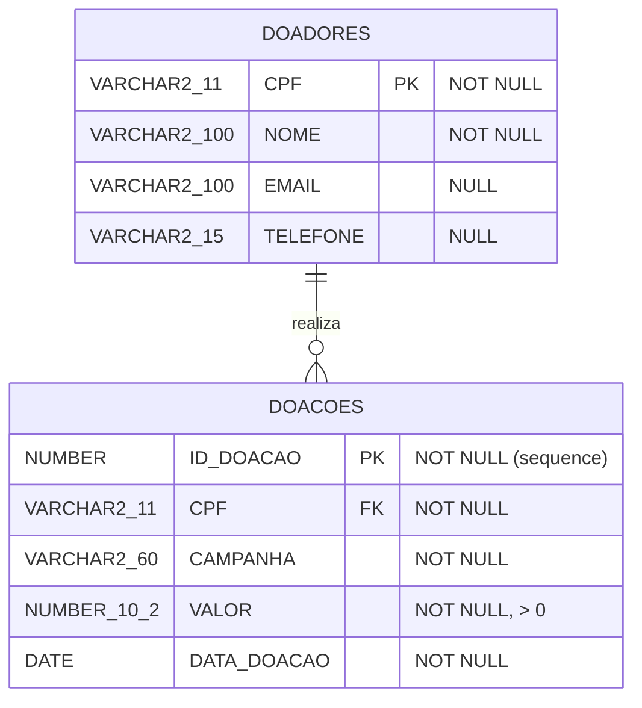

# Sistema de Doações para ONG

Trabalho C2 da disciplina de **Banco de Dados** — Semestre **2026/2**

## 📋 Descrição

Sistema CRUD em **Python 3 + Oracle** para gerenciar doações de uma ONG. O programa permite cadastrar doadores, registrar doações vinculadas a campanhas e gerar relatórios de arrecadação. Desenvolvido como fork do projeto de exemplo [howardroatti/example_crud_oracle](https://github.com/howardroatti/example_crud_oracle).

## 👥 Integrantes

| Nome | Responsabilidade |
|------|-----------------|
| Amon | Fork, scripts SQL, dados de exemplo, `principal.py` |
| Gabriel | Models (`Doador`, `Doacao`) e `controller_doador.py` |
| Maria Vitória | `controller_doacao.py` |
| Pedro Paulo | Relatórios, menus (`config.py`) e `splash_screen.py` |
| Ricardo | Diagrama relacional, README, PROMPTS, vídeo e testes |

## 🗂️ Estrutura do Repositório

```
diagrams/    DIAGRAMA_RELACIONAL_DOACOES.pdf / .png / .mmd
sql/         create_tables_doacoes.sql, inserting_samples_records.sql
src/
  conexion/oracle_queries.py              (reaproveitado do fork)
  model/doadores.py, doacoes.py
  controller/controller_doador.py, controller_doacao.py
  reports/relatorios.py
  sql/relatorio_arrecadacao_por_campanha.sql, relatorio_doacoes.sql, relatorio_doadores.sql
  utils/config.py, splash_screen.py
  create_tables_and_records.py, principal.py, requirements.txt
README.MD    PROMPTS.md    LICENSE
```

## 📊 Diagrama Relacional

O diagrama Mermaid está em [`diagrams/DIAGRAMA_RELACIONAL_DOACOES.mmd`](diagrams/DIAGRAMA_RELACIONAL_DOACOES.mmd) e as versões exportadas em PDF e PNG na mesma pasta.



**Cardinalidade:** um doador tem 0..N doações, e cada doação pertence a exatamente 1 doador.

## 🚀 Como Rodar (Linux — VM da Disciplina)

### Pré-requisitos

- Python 3 instalado
- Oracle Database acessível (a VM da disciplina já vem configurada)
- Módulo `cx_Oracle` e `pandas` (listados em `requirements.txt`)

### Passo a passo

1. **Clone o repositório:**
   ```bash
   git clone https://github.com/<usuario>/sistema-doacoes-ong.git
   cd sistema-doacoes-ong
   ```

2. **Instale as dependências:**
   ```bash
   cd src
   pip install -r requirements.txt
   ```

3. **Configure as credenciais do banco:**
   
   Crie ou edite o arquivo `src/conexion/passphrase/authentication.oracle` com o usuário e a senha da VM, no formato:
   ```text
   labdatabase,lab@Database2025
   ```
   > **Nota:** o arquivo contém `usuario,senha` em uma única linha, sem espaços.

4. **Crie as tabelas e insira os dados de exemplo:**
   ```bash
   python create_tables_and_records.py
   ```
   Isso executa os scripts `sql/create_tables_doacoes.sql` e `sql/inserting_samples_records.sql`.

5. **Execute o programa principal:**
   ```bash
   python principal.py
   ```

### Funcionalidades disponíveis no menu

| Opção | Ação |
|-------|------|
| 1 | **Relatórios** — Arrecadação por campanha, Doações detalhadas, Lista de doadores |
| 2 | **Inserir Registros** — Cadastrar doadores e doações |
| 3 | **Atualizar Registros** — Alterar dados de doadores e doações |
| 4 | **Remover Registros** — Excluir doadores (com verificação de FK) e doações |
| 5 | **Sair** |

## 🎥 Vídeo de Demonstração

🔗 **Link do YouTube:** https://youtu.be/y5SLDczoaH4

O vídeo demonstra todas as funcionalidades do sistema (5–8 minutos):
1. Objetivo do sistema e diagrama relacional
2. Splash screen com contagens de registros
3. Relatórios (arrecadação por campanha + doações detalhadas)
4. Inserção de doador e doação
5. Atualização de registro
6. Remoção de doação e remoção de doador com doações (verificação de FK)
7. Splash atualizado e saída

## 📝 Licença

Este projeto foi desenvolvido para fins acadêmicos.
